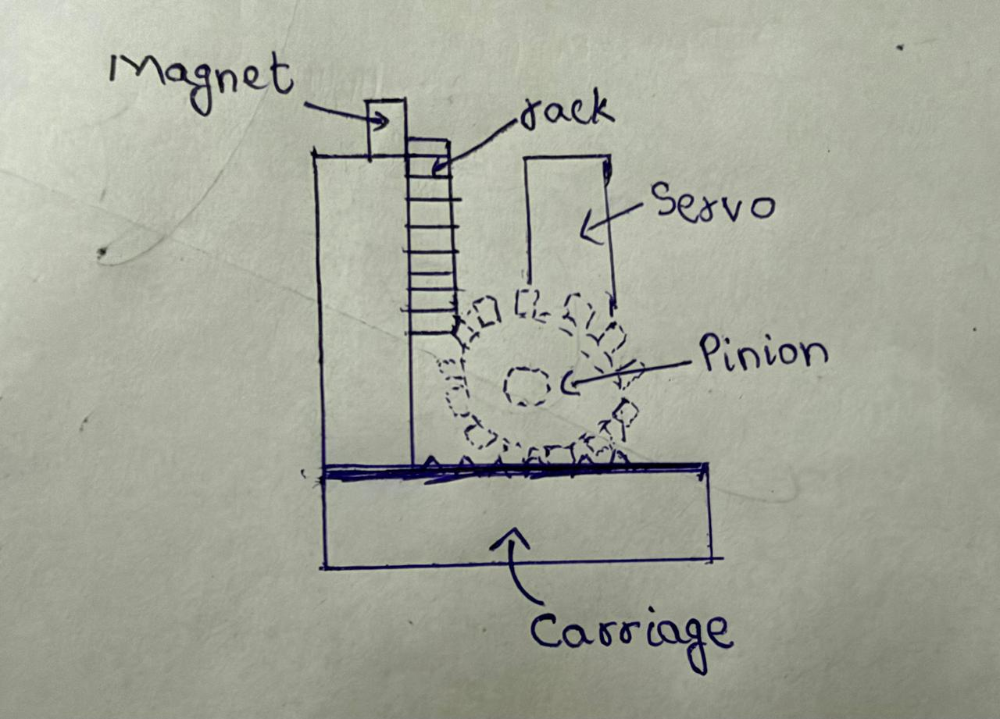
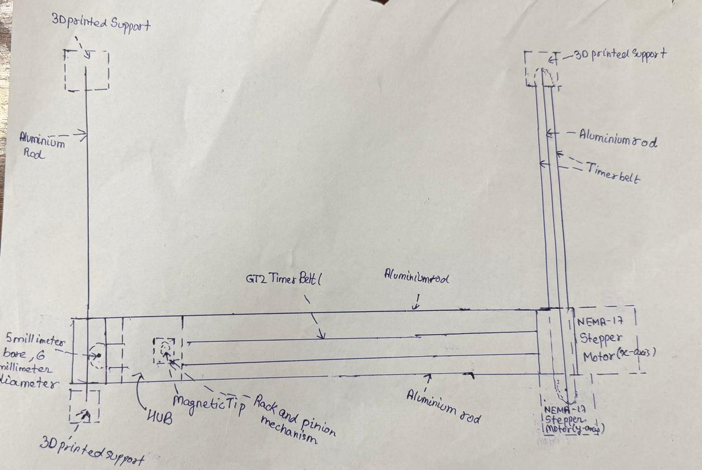

# ChessE

ChessE is a physical, vision-assisted chess robot that combines computer vision, Stockfish, gantry path planning, and Arduino-controlled motion.

The camera observes a 10 × 10 workspace: an 8 × 8 chessboard surrounded by a parking ring for captured pieces.

## Prototype

<p align="center">
  
  &nbsp;
  
</p>

<p align="center">
  <em>Prototype sketches: magnetic rack-and-pinion probe mechanism and gantry assembly.</em>
</p>

## Features

- Detects human moves through OpenCV
- Uses python-chess to track legal moves and game state
- Uses Stockfish to calculate robot moves
- Plans gantry paths for captures, castling, promotions, and en passant
- Supports USB and IP cameras
- Controls an X/Y gantry using an Arduino
- Detects pieces placed in the parking ring
- Calibrates camera perspective and board orientation
- Saves game state as FEN and PGN

## Repository Structure

```text
ChessE/
├── CAD/
│   ├── Chess_Pieces.FCStd
│   ├── Gantry.FCStd
│   ├── Gantry_Frame/
│   └── Probe/
├── chessbot/
│   ├── chess_vision.py
│   ├── board_tester.py
│   └── test_*.py
├── docs/
│   ├── Magnetic_Rack_pinion.jpg
│   └── Gantry-prototype.jpg
└── firmware/
    ├── gantry_test.ino
    ├── probe_test.ino
    └── translation layer.ino
```

- `CAD/` contains FreeCAD models for the gantry, chess pieces, frame, and probe
- `chessbot/` contains the Python vision, chess engine, and gantry control code
- `docs/` contains prototype sketches and documentation images
- `firmware/` contains Arduino firmware and hardware test sketches

## How It Works

1. A camera captures the complete 10 × 10 workspace.
2. OpenCV warps the image into a consistent top-down view.
3. The board is calibrated against the standard starting position.
4. Human moves are matched against the positions produced by legal moves.
5. Stockfish selects the robot's reply.
6. The gantry planner converts the move into grid-based commands.
7. Arduino firmware moves the gantry and raises or lowers the magnetic probe.
8. The camera verifies the chessboard and parking-ring cells.

## Requirements

### Python

- Python 3
- OpenCV
- NumPy
- python-chess
- PySerial
- Stockfish

Install the Python dependencies:

```bash
python -m pip install opencv-python numpy python-chess pyserial
```

Stockfish must be installed and available on `PATH`, or supplied through `--stockfish`.

### Hardware

- Arduino-compatible board
- X/Y stepper gantry
- Stepper motor drivers
- Servo-controlled magnetic probe
- USB or network camera
- Chess pieces and 10 × 10 workspace

## Arduino Firmware

Upload `firmware/translation layer.ino` to the Arduino.

The firmware:

- Controls X and Y stepper motors
- Uses a servo-controlled rack and magnet
- Accepts a starting cell and waypoint path over serial
- Supports workspace names such as `b8`, `y9`, and `x61`
- Returns the gantry to `y9` after each move

Place the gantry hub on `y9`, the bottom-left workspace corner, before resetting or starting the Arduino.

## Running the Chess Robot

### USB webcam

```bash
cd chessbot
python chess_vision.py --camera 0 --robot black
```

### IP camera

```bash
python chess_vision.py --camera "http://172.16.129.68:8080/video" --robot black
```

Replace the example URL with the address of your camera stream.

### Automatic Arduino Control

```bash
python chess_vision.py --camera 0 --robot black --port COM5
```

Linux example:

```bash
python chess_vision.py --camera 0 --robot black --port /dev/ttyUSB0
```

Close the Arduino Serial Monitor before starting Python because the serial port cannot be shared.

### Recalibrate the Workspace

```bash
python chess_vision.py --recalibrate --camera 0
```

## Controls

During calibration:

- Click the four outer corners of the 10 × 10 workspace
- Press `Enter` to accept the detected grid
- Press `R` to repeat calibration

During play:

- `SPACE` — confirm that a move has been completed
- `F` — carry on when the camera is incorrect but the physical board is correct
- `Q` or `Esc` — quit

## Testing the Gantry

### Send a Move

```bash
python board_tester.py --port COM5 --move e2e4
```

With a custom position:

```bash
python board_tester.py --port COM5 --move b8c6 --fen "rnbqkbnr/pppppppp/8/8/4P3/8/PPPP1PPP/RNBQKBNR b KQkq - 0 1"
```

### Send a Saved Plan

```bash
python board_tester.py --port COM5 --file gantry_commands.txt
```

### Dry Run

```bash
python board_tester.py --dry-run --move e2e4
```

### Manual Command

```text
b8 {b91, x91, x61, c60}
```

The first value is the starting cell. The remaining values are workspace cells followed by the rack state:

- `1` — rack/magnet raised
- `0` — rack/magnet lowered

## Generated Files

| File | Purpose |
|---|---|
| `workspace_corners.json` | Saved camera calibration |
| `current.fen` | Current board position |
| `bestmove.txt` | Latest Stockfish move |
| `gantry_commands.txt` | Latest gantry path |
| `game.pgn` | Completed or interrupted game |

## Calibration Notes

- Use consistent overhead lighting.
- Avoid strong shadows across the workspace.
- Ensure the entire board and parking ring are visible.
- Place all pieces in the standard starting position for initial calibration.
- Keep the parking ring empty during calibration.
- Reset the Arduino only while the hub is on `y9`.

## License

No license is currently specified. Consult the repository owner before commercial use or redistribution.
